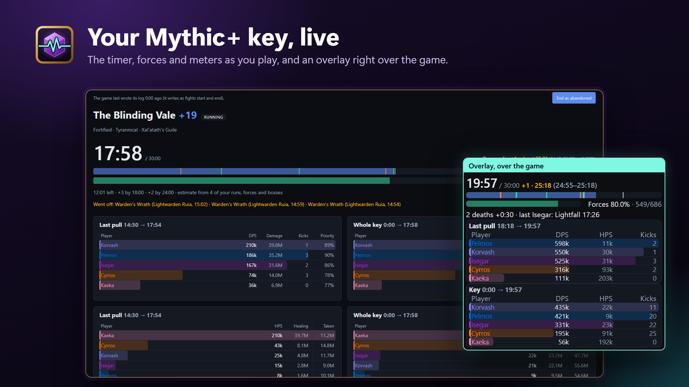
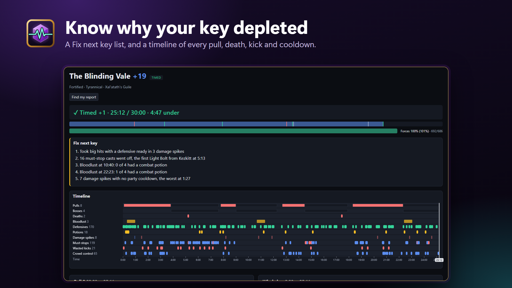
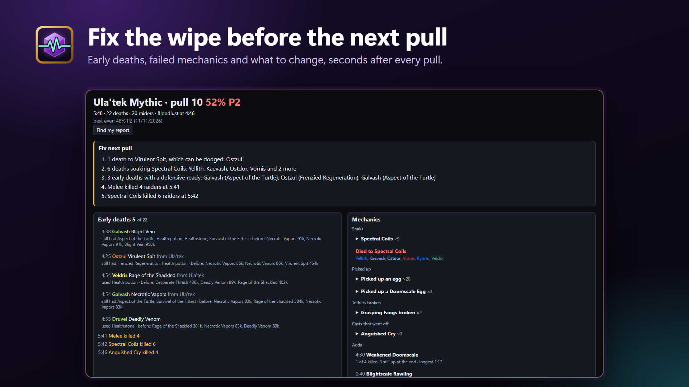
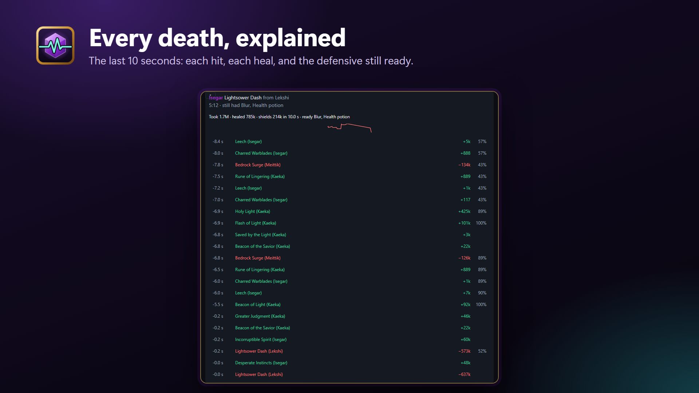
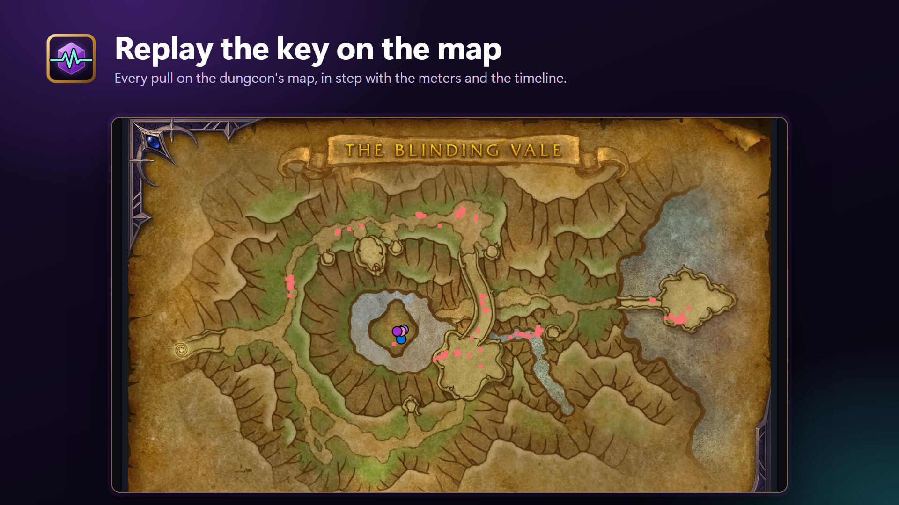
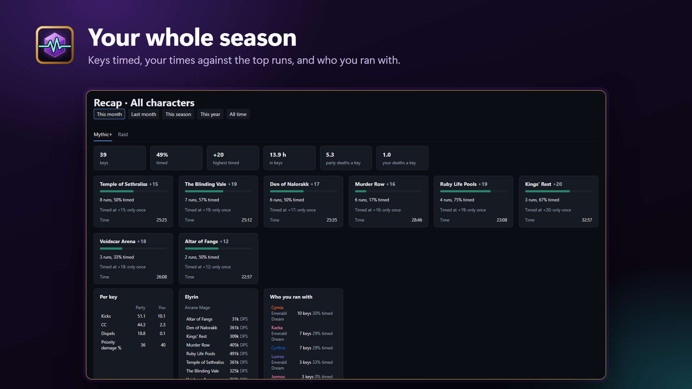

# WoW Live

**Know why your key depleted, and why the raid wiped.**

A free Windows app for World of Warcraft Mythic+ and raids. It reads the combat log the game writes on your PC as
you play: a live timer and meters with an overlay over the game, every death explained, and a short list of what to
fix after every key and every raid pull. No addon, nothing uploaded.

**[Get it from the Microsoft Store](https://apps.microsoft.com/detail/9pfg7vnt6j89)**

## What it shows

- **During a key:** the clock against the timer with the +2 and +3 marks, enemy forces, the result you're heading
  for, the must-stop casts that went off, deaths, kicks and DPS / HPS, on an overlay that fits its window.
- **After a key:** a *Fix next key* list, every death and big hit with its last 10 seconds (each hit, each heal, the
  defensive still ready), damage spikes that name what hit the party, each player against the top runs of their spec
  on Warcraft Logs, and a replay on the dungeon's map.
- **After a raid pull:** how far it got, the early deaths and why, what went wrong by mechanic, and what to fix on
  the next pull.
- **Your season:** a Recap per character, Mythic+ and Raid apart: keys timed, your times against the top runs, who
  you ran with and your Warcraft Logs parses.

More: death recaps, the map replay and the Recap

*Screenshots from real keys and pulls, with the players' names made up.*

## Install

1. Get it from the [Microsoft Store](https://apps.microsoft.com/detail/9pfg7vnt6j89).
2. In the game, turn on **Advanced Combat Logging** (Options > System > Network) and type `/combatlog` before the key
   or the pull.
3. Optional, for the comparison with top runs: make a client at
   [warcraftlogs.com/api/clients](https://www.warcraftlogs.com/api/clients) (any name, redirect URL `http://localhost`)
   and paste its ID and secret in WoW Live's **Settings** tab.

Play in Windowed or Windowed (Fullscreen) mode so the overlay shows over the game. Ctrl+Alt+O moves and resizes it,
and Ctrl+Alt+K lets clicks through to the game.

**Had the earlier installer?** Uninstall it (Windows Settings > Apps > Installed apps > WoW Live) before installing
from the Store. Its settings and saved keys stay in `%LOCALAPPDATA%\WoW Live`; delete that folder to remove them.

Questions or bugs: [open an issue](../../issues). Privacy: [what it keeps and downloads](PRIVACY.md).

World of Warcraft is a trademark of Blizzard Entertainment; WoW Live isn't affiliated with Blizzard. Dungeon maps are
Keystone.guru's and raid maps Warcraft Logs'.
